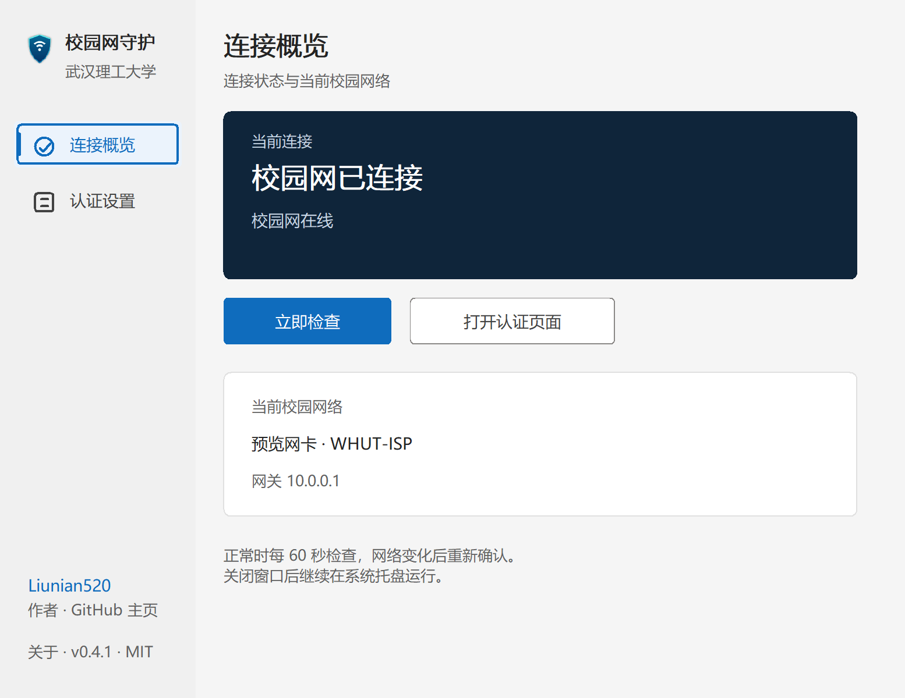
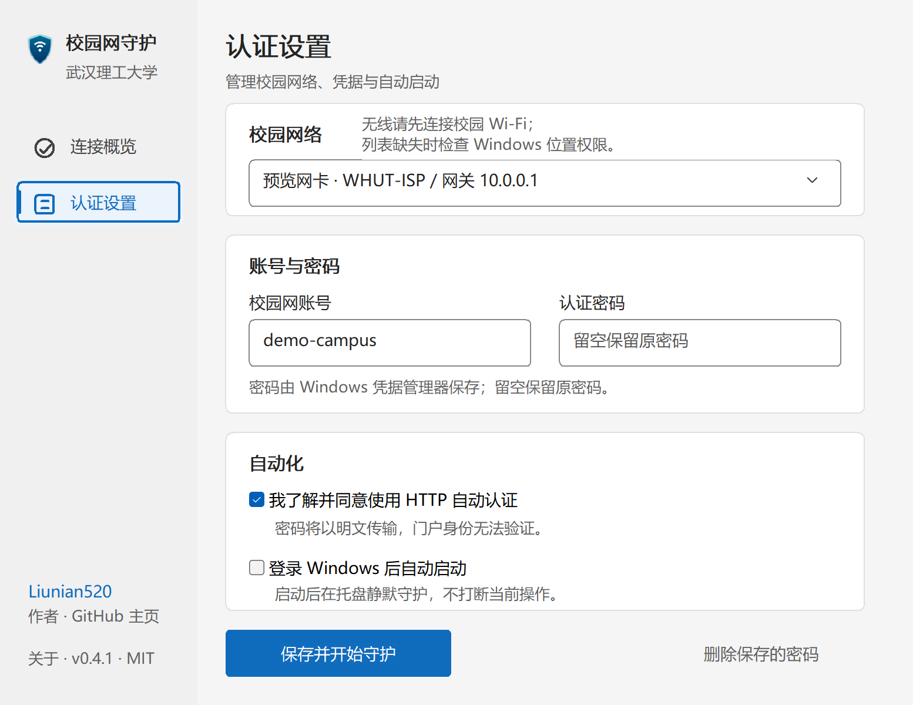

  

<h1 align="center">校园网守护</h1>

为武汉理工大学 WHUT-ISP 宿舍网络设计的轻量 Windows 守护工具

  
  
  
  

  <a href="https://github.com/Liunian520/campus-network-guardian/releases/latest"><strong>下载 Windows 版</strong></a>
  · <a href="#三步开始守护">使用方法</a>
  · <a href="docs/开发与验证.md">开发与验证</a>
  · <a href="https://github.com/Liunian520">作者主页</a>

保存自己的账号和密码后，程序在托盘中检查连接：校园认证失效时自动登录，校园认证仍在线且运营商明确拨号失败时尝试重拨。界面使用 Rust + Win32，不依赖常驻浏览器或 WebView。

这是由 [Liunian520](https://github.com/Liunian520) 维护的个人开源项目，与武汉理工大学及运营商无隶属关系。

## 下载安装

在[最新发布页](https://github.com/Liunian520/campus-network-guardian/releases/latest)选择对应文件。支持 **Windows 10 1607 及更新版本 / Windows 11，x64**，无需另外安装 VC++ 运行库。

| 下载内容 | 适合谁 | 说明 |
| --- | --- | --- |
| **`…-windows-x64-setup.exe`** | 推荐，大多数用户 | 无需管理员权限，提供开始菜单和卸载入口；默认勾选“登录 Windows 后自动启动”，可取消 |
| `…-windows-x64-portable.zip` | 希望自行管理文件 | 解压后运行，将目录保留在固定位置；可在设置中开启自启动 |
| `SHA256SUMS.txt` | 核对下载内容 | 提供安装包和便携包的 SHA-256 校验值 |

安装包不含个人账号、配置或凭据，尚未做商业代码签名，Windows 可能显示未知发布者提示。

## 能做什么

| 功能 | 行为 |
| --- | --- |
| 自动恢复校园认证 | 使用已保存的凭据；选定网卡与保存的网络身份匹配时才发送认证请求 |
| 运营商重拨 | 区分校园认证和运营商状态；明确拨号失败时尝试重拨，拨号中等待结果 |
| 登录后自动启动 | 可在设置中开关；关闭窗口后继续在系统托盘运行 |
| 安全保存密码 | 使用当前 Windows 用户的凭据管理器，可在设置中删除密码 |
| 分级重试 | 临时故障退避重试；验证码、密码错误等情况提示人工处理 |
| 原生桌面界面 | 连接概览、认证设置、键盘操作、DPI 缩放和短屏滚动 |

## 网络支持范围

本项目针对[武汉理工大学宿舍运营商网络 **WHUT-ISP**](https://nic.whut.edu.cn/service_guides/network/202609/t20260904_1415668.html)，适配使用同一认证门户的有线与无线接入，不承诺兼容 WHUT-1X、WHUT-WLAN 或其他学校的认证系统。

| 接入场景 | 当前支持 | 使用前提与边界 |
| --- | --- | --- |
| 宿舍有线校园网 | 支持 | 首次选择当前连接的物理以太网网卡并保存；网卡与网关需匹配 |
| WHUT-ISP 无线网络 | 条件支持 | 先连接 Wi-Fi，再选择无线网卡并保存；需读取 SSID，Windows 可能要求位置权限 |
| 无线断开后重连、IP 改变 | 自动重新确认 | 已保存的无线网卡、SSID 与网关仍需匹配 |
| 同一无线网络内 AP 漫游 | 可继续守护 | 网卡、SSID 与网关保持不变；不绑定 AP 的 BSSID |
| 有线与无线互相切换 | 需要重新选择 | 目前只保存一个网络身份，不会自动从已保存的有线网卡切换到无线网卡 |
| Wi-Fi 尚未连接 | 由 Windows 连接 | 程序不会自动选择或连接 Wi-Fi |
| 网卡、网关或 SSID 改变 | 暂停认证操作 | 重新确认网络并保存设置；身份无法确认时不发送密码 |
| 欠费、停机、验证码、密码错误 | 需要人工处理 | 按提示打开门户或联系运营商，程序无法代为解决 |

无线 SSID 无法读取时，程序不会把该无线连接列为可选校园网网卡，也不会向它发送密码；可检查 Windows 的位置服务及桌面应用位置权限。更多协议与实测边界见[开发与验证](docs/开发与验证.md#已完成的验证与限制)。

## 界面预览

以下为 **v0.4.1 离屏预览，全部使用虚构数据**。侧栏保留作者署名、GitHub 主页与版本信息。

查看认证设置界面

## 三步开始守护

1. **先连接校园网。** 安装程序，或解压便携包后运行；首次启动进入“认证设置”。
2. **选择网络并填写账号。** 选择当前校园网网卡，填写自己的校园网账号和认证密码，阅读并确认 HTTP 风险。使用无线网络时，先连接 Wi-Fi，再选择对应网卡。
3. **保存并开始守护。** 按需开启自启动，点击“保存并开始守护”。以后启动会自动使用保存的配置与凭据；关闭窗口会回到托盘，双击盾牌图标可重新打开。

**HTTP 风险：**学校当前认证门户使用 HTTP，密码传输不受 TLS 保护，门户身份也无法验证。匹配网卡、网关和 SSID 只能降低误发风险，不能防止同一网络上的监听或篡改。启用前请阅读[安全说明](SECURITY.md)。

托盘右键提供立即检查、设置、打开认证页面和退出。系统可能折叠托盘图标，也可能延迟登录后的自动启动。升级保留设置；卸载默认保留账号配置和凭据，如需清除密码，请先在应用设置中删除。

## 开发、反馈与协议

| 入口 | 内容 |
| --- | --- |
| [开发与验证](docs/开发与验证.md) | 构建、模拟测试、界面预览、安装器验收及真实网络验证边界 |
| [贡献说明](CONTRIBUTING.md) | 报告问题、提交改动和本地检查 |
| [安全说明](SECURITY.md) | HTTP 限制、敏感信息保护和私密漏洞报告 |
| [Issues](https://github.com/Liunian520/campus-network-guardian/issues) | 功能建议与脱敏问题反馈 |

作者：[Liunian520](https://github.com/Liunian520)。代码与自有图标采用 [MIT License](LICENSE)；依赖和安装器翻译保留各自的[许可证与声明](THIRD-PARTY-NOTICES.md)。
