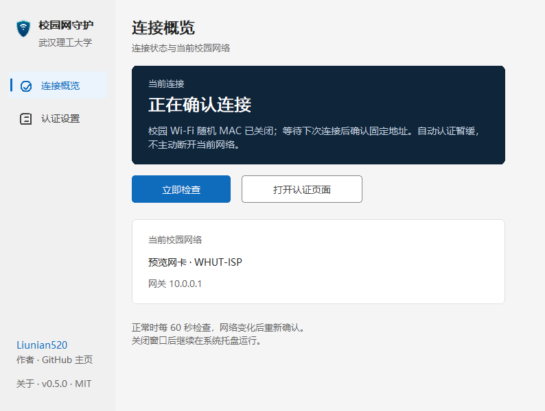
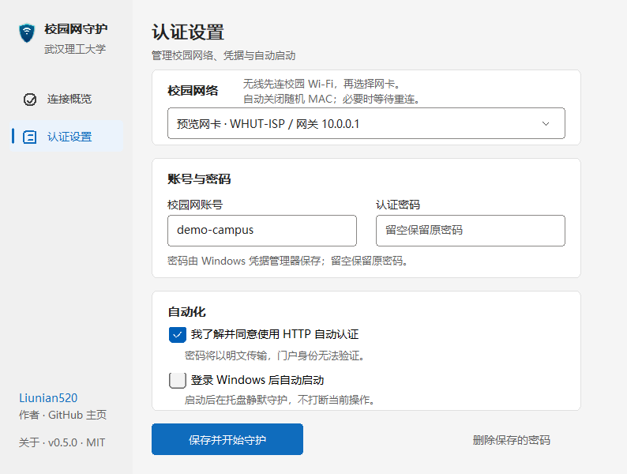

  

<h1 align="center">校园网守护</h1>

为武汉理工大学 WHUT-ISP 宿舍网络设计的轻量 Windows 守护工具

  
  
  
  

  <a href="https://github.com/Liunian520/campus-network-guardian/releases/latest"><strong>下载 Windows 版</strong></a>
  · <a href="#三步开始守护">使用方法</a>
  · <a href="docs/开发与验证.md">开发与验证</a>
  · <a href="https://github.com/Liunian520">作者主页</a>

保存自己的账号和密码后，程序在托盘中检查连接：校园认证失效时自动登录，校园认证仍在线且运营商明确拨号失败时尝试重拨。界面使用 Rust + Win32，不依赖常驻浏览器或 WebView。

这是由 [Liunian520](https://github.com/Liunian520) 维护的个人开源项目，与武汉理工大学及运营商无隶属关系。

## 下载安装

支持 **Windows 10 1607 及更新版本 / Windows 11，x64**，无需另外安装 VC++ 运行库。可从两个发布页下载。 [流年 App 下载页](https://app.liunianai.cn/apps/campus-network-guardian) · [GitHub 最新发布页](https://github.com/Liunian520/campus-network-guardian/releases/latest)

| 下载内容 | 适合谁 | 说明 |
| --- | --- | --- |
| **`…-windows-x64-setup.zip`** | 推荐，从流年 App 或 GitHub 下载 | 完整解压后运行其中的安装程序。包内附有 `安装说明.txt` |
| `…-windows-x64-setup.exe` | 希望从 GitHub 直接运行安装程序 | 无需管理员权限，提供开始菜单和卸载入口，可选择登录 Windows 后自动启动 |
| `…-windows-x64-portable.zip` | 希望自行管理文件 | 解压后运行，将目录保留在固定位置。可在设置中开启自启动 |
| `SHA256SUMS.txt` | 核对下载内容 | 提供安装程序、安装 ZIP 和便携 ZIP 的 SHA-256 校验值 |

安装包不含个人账号、配置或凭据，尚未做商业代码签名，Windows 可能显示未知发布者提示。

### 自动更新

从 v0.6.3 起，程序启动片刻后会自动检查正式版，运行期间每 6 小时再检查一次。v0.6.8 起，同时检查流年 App 与 GitHub 官方发布接口，选择版本号较高的稳定正式版。其中一个来源不可达时，另一来源仍可独立提供更新。

下载前探测流年 App 的 CF CDN、`gh-proxy.com` 镜像和 GitHub 官方下载，结合当前网络和文件大小选择同版线路。文件达到 1 MiB 时按大小使用 2–4 个线程。服务器不支持分段或分段验证失败时，重新以单线程下载。

程序按可信发布接口提供的大小和 SHA-256 校验下载内容。使用流年 App 的安装 ZIP 时，程序还会检查包内的安装器。两源提供同一版本时，程序会核对其与 GitHub 官方安装器是否一致。通过校验后，程序静默更新并重启。

点击侧栏“检查更新”即可在程序的原生公告窗口查看版本、来源、当前进度和更新说明。

安装版原地升级。便携版请将 `campus-network-guardian.exe` 保留在可写目录并使用原文件名，程序会原地替换该文件。升级沿用现有配置和凭据。检查或下载失败时，运行中的程序会在 30 分钟后重试。升级自动重启后，下一次检查间隔 6 小时。

静默更新完成后，程序以普通权限重启。需要自动切换 IPv4 出口时，可再以管理员身份启动。

v0.5.1 及更早版本需先手动升级一次。请下载适合当前使用方式的安装包或便携包。 [GitHub 最新正式版](https://github.com/Liunian520/campus-network-guardian/releases/latest)

## 能做什么

| 功能 | 行为 |
| --- | --- |
| 自动恢复校园认证 | 分别检查已保存的校园网连接，确认各自的网络身份后，用已保存的凭据恢复过期的认证 |
| 校园网出口切换 | 同时保存 WHUT-ISP 和以太网时默认使用无线优先、有线兜底的策略。调整 IPv4 默认路由需要以管理员身份运行 |
| 识别实际认证入口 | 登录前通过所选连接的无凭据探针获取 NAS，核对门户地址与本机 IP；不使用可能属于其他接入设备的默认入口 |
| 关闭校园 Wi-Fi 随机 MAC | 仅处理所选校园 Wi-Fi 配置；核对当前 MAC 与永久硬件地址一致后才发送认证凭据 |
| 运营商重拨 | 区分校园认证和运营商状态；明确拨号失败时尝试重拨，拨号中等待结果 |
| 登录后自动启动 | 可在设置中开关；关闭窗口后继续在系统托盘运行 |
| 自动更新 | 流年 App 与 GitHub 双源检查，按网络状况选路，校验后静默更新。程序内可查看公告 |
| 安全保存密码 | 使用当前 Windows 用户的凭据管理器，可在设置中删除密码 |
| 分级重试 | 临时故障退避重试；验证码、密码错误等情况提示人工处理 |
| 原生桌面界面 | 连接概览、认证设置、键盘操作、DPI 缩放和短屏滚动 |

## 匿名使用统计

从 v0.6.9 起，可在「认证设置 → 匿名使用统计」勾选允许发送。托盘菜单也可打开该位置。默认关闭，勾选后即时生效。

启用后，每个北京时间自然日最多向流年 App 发送一次应用活跃事件，由服务端转交 Link 应用统计。事件包含随机安装和会话标识、时间、应用版本、Windows 平台及发布渠道。关闭会清除本机随机安装标识并停止发起新请求，已发出的请求可能完成。校园网账号、密码、网卡和 Wi-Fi 信息不参与统计。

## 连接诊断

从 v0.7.0 起，打开「连接概览」可分别查看每条已保存线路的网络接入、校园网认证、运营商拨号和 IPv4 外网状态。

点击「检测外网」后，程序在后台从匹配的网卡发送一次只读探测。检测通过代表该线路可以访问探测端点，检测未通过时显示「暂时无法确认」。点击「查看恢复记录」可看到最近的状态变化、认证与重拨结果。「复制诊断」包含下次计划检查时间和最近 32 条记录，使用固定标签，省去账号、IP、MAC 和 Wi-Fi 名称。

## 网络支持范围

本项目针对[武汉理工大学宿舍运营商网络 **WHUT-ISP**](https://nic.whut.edu.cn/service_guides/network/202609/t20260904_1415668.html)，适配使用同一认证门户的有线与无线接入，不承诺兼容 WHUT-1X、WHUT-WLAN 或其他学校的认证系统。

| 接入场景 | 当前支持 | 使用前提与边界 |
| --- | --- | --- |
| 宿舍有线校园网 | 协议适配 | 首次选择当前连接的物理以太网网卡并保存；网卡与网关需匹配。真实有线自动登录恢复尚未单独验证 |
| WHUT-ISP 无线网络 | 已验证一次真实自动恢复 | 先连接 Wi-Fi，再选择无线网卡并保存；需读取 SSID，并确认当前 MAC 为永久硬件地址 |
| 无线断开后重连、IP 改变 | 自动重新确认 | 已保存的无线网卡、SSID 与网关仍需匹配 |
| 同一无线网络内 AP 漫游 | 可继续守护 | 网卡、SSID 与网关保持不变；不绑定 AP 的 BSSID |
| 有线与无线同时接入或交替使用 | 可分别守护 | 在设置中明确选择两个校园网连接，共用同一账号、密码和 HTTP 授权。分别检查并恢复各自的认证 |
| Wi-Fi 尚未连接 | 由 Windows 连接 | 程序不会自动选择或连接 Wi-Fi |
| 网卡、网关或 SSID 改变 | 暂停对应连接的认证操作 | 在设置中重新确认该网络并保存，认证请求只走已确认的连接 |
| 欠费、停机、验证码、密码错误 | 需要人工处理 | 按提示打开门户或联系运营商，程序无法代为解决 |

添加或认证无线连接时，程序需要读取该网络的 SSID。读取失败时可检查 Windows 的位置服务及桌面应用位置权限。更多协议与实测边界见[开发与验证](docs/开发与验证.md#已完成的验证与限制)。

### WHUT-ISP 优先，以太网兜底

同时保存 WHUT-ISP 和以太网后，程序默认优先使用门户确认可用的 WHUT-ISP。无线失效且以太网确认可用时切换到以太网，无线恢复后切回。这个策略只调整两个已保存连接的 IPv4 默认路由，判断依据是校园认证和运营商拨号状态。

Windows 要求管理员权限才能修改路由。如果当前程序正在托盘运行，先退出，再右键程序选择 **以管理员身份运行**。普通启动或登录后自启动仍会守护两张网卡的认证，界面会提示出口切换所需的权限。参阅 [Microsoft 的 IPv4 路由 API 说明](https://learn.microsoft.com/en-us/windows/win32/api/netioapi/nf-netioapi-setipforwardentry2)。

### 校园 Wi-Fi 随机硬件地址

从 v0.5.0 起，守护无线网络时会自动尝试关闭**所选校园 Wi-Fi 配置**的随机硬件地址，并核对当前 MAC 与网卡永久硬件地址。只有确认一致后，才会发送校园认证凭据；旧配置仍可读取，无须新增开关。

| 情况 | 程序行为 |
| --- | --- |
| 所选连接为有线网卡 | 不修改 MAC |
| 所选校园 Wi-Fi 启用了随机地址 | 尝试关闭该 Wi-Fi 配置的随机化，不全局关闭，也不伪造或指定新 MAC |
| 配置已关闭随机化，当前地址尚未变更 | 等待自然重连后再次确认，不主动断开或重连 Wi-Fi |
| 权限不足、组策略管理、附加用户数据等使修改无法安全完成 | 停止自动修改，提示人工在 Windows 中处理；不继续提交认证凭据 |

手动处理可打开 **Windows 设置 → 网络和 Internet → Wi-Fi → 管理已知网络**，选择校园网络并关闭“随机硬件地址”。系统应用配置后的实际 MAC 仍需重新确认，程序不会为了立即生效而重置网卡。程序不主动重连，但无法保证 Windows 或驱动应用配置时完全没有连接波动。

此设置会保留在 Windows 的该 Wi-Fi 配置中，退出或卸载程序不会自动恢复随机化。需要恢复时，可在上述 Windows 设置中重新开启；再次运行守护时仍会尝试关闭。

固定 MAC 只解决地址变化这一项因素；认证过期、运营商状态或账户异常仍可能导致无法上网。本次实测的随机化原本已关闭，当前 MAC 与永久地址相同；尚未完成“真实开启随机化后由程序关闭”的配置写入与地址切换验证，详见[验证限制](docs/开发与验证.md#已完成的验证与限制)。

## 本次真实验证

2026-11-17，在本机 **WHUT-ISP 无线网络**上验证了 v0.5.1 生产程序：

| 项目 | 实际结果 |
| --- | --- |
| 自动认证恢复 | 启动后约 **13 秒**从未认证状态恢复为校园认证在线、运营商拨号成功；用户未手动网页登录，测试没有主动断开或重连 Wi-Fi |
| 校园网出口 | USB 共享网络保持连接；通过绑定无线网卡和源 IP 的独立请求，确认 Microsoft HTTP 探针内容正确，并完成百度 HTTPS 证书校验与 HTTP 200 验证 |
| 空闲占用 | 单次样本：私有内存 **2.64 MiB**，工作集 **16.05 MiB**；不代表认证期间峰值或所有电脑的上限 |

v0.5.1 修复了默认 NAS 与实际无线接入 NAS 不一致的问题，实际 NAS 从当前连接的重定向中识别，不写死编号。登录前的 Microsoft 连通性探针不携带账号、密码或 Cookie；认证凭据仍只提交给固定校园门户。详细过程及 DNS 诊断边界见[开发与验证](docs/开发与验证.md#已完成的验证与限制)。

## 界面预览

以下为 **v0.5.0 离屏预览，全部使用虚构数据**，v0.5.1 沿用此布局。侧栏保留作者署名、GitHub 主页与版本信息。

查看认证设置界面

## 三步开始守护

1. **先连接校园网。** 安装程序，或解压便携包后运行；首次启动进入“认证设置”。
2. **选择网络并填写账号。** 在“主网络”选择已连接的校园网网卡。需要同时守护以太网和 WHUT-ISP 时，先连接两张网卡，再在“第二个网络（可选）”中选中另一张。填写自己的校园网账号和认证密码，阅读并确认 HTTP 风险。所选连接共用这组凭据和授权。
3. **保存并开始守护。** 按需开启自启动，点击“保存并开始守护”。无线连接会先检查随机硬件地址；如提示等待重连或手动处理，请按状态说明操作。以后启动会自动使用保存的配置与凭据；关闭窗口回到托盘，双击盾牌图标可重新打开。

**HTTP 风险：**学校当前认证门户使用 HTTP，密码传输不受 TLS 保护，门户身份也无法验证。匹配网卡、网关和 SSID 只能降低误发风险，不能防止同一网络上的监听或篡改。启用前请阅读[安全说明](SECURITY.md)。

托盘右键提供立即检查、设置、打开认证页面和退出。系统可能折叠托盘图标，也可能延迟登录后的自动启动。升级后原有的单网卡设置仍可使用。卸载默认保留账号配置和凭据，如需清除密码，请先在应用设置中删除。

## 开发、反馈与协议

| 入口 | 内容 |
| --- | --- |
| [开发与验证](docs/开发与验证.md) | 构建、模拟测试、界面预览、安装器验收及真实网络验证边界 |
| [贡献说明](CONTRIBUTING.md) | 报告问题、提交改动和本地检查 |
| [安全说明](SECURITY.md) | HTTP 限制、敏感信息保护和私密漏洞报告 |
| [Issues](https://github.com/Liunian520/campus-network-guardian/issues) | 功能建议与脱敏问题反馈 |

作者：[Liunian520](https://github.com/Liunian520)。代码与自有图标采用 [MIT License](LICENSE)；依赖和安装器翻译保留各自的[许可证与声明](THIRD-PARTY-NOTICES.md)。
