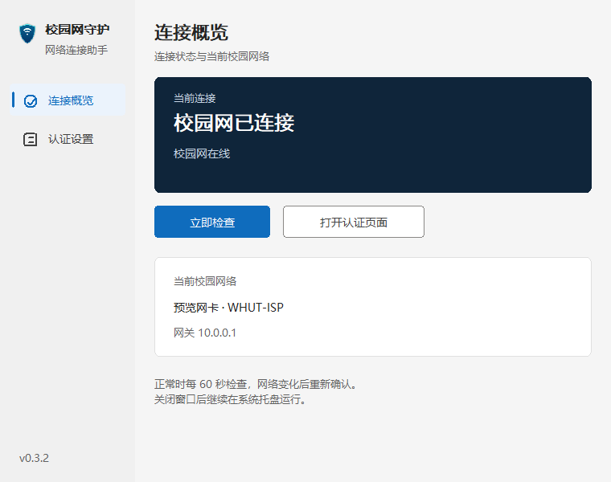

# 校园网守护

[](https://github.com/Liunian520/campus-network-guardian/actions/workflows/ci.yml)
[](LICENSE)

适用于武汉理工大学宿舍运营商校园网的轻量 Windows 托盘工具。使用 Rust + Win32，无浏览器常驻进程，保存凭据后根据门户状态自动恢复校园认证或运营商拨号。个人项目，与学校及运营商无隶属关系。

## 下载安装

到 [最新版本下载页](https://github.com/Liunian520/campus-network-guardian/releases/latest) 下载：

- **推荐：** `campus-network-guardian-版本号-windows-x64-setup.exe`，双击后点击安装。默认勾选“登录 Windows 后自动启动”，可取消；无需管理员权限。安装到当前用户的 `%LOCALAPPDATA%\Programs\CampusNetworkGuardian`，提供开始菜单入口及标准卸载。
- **免安装：** `campus-network-guardian-版本号-windows-x64-portable.zip`，解压后运行；在设置中开启自启动，并将文件保留在固定位置。
- `SHA256SUMS.txt` 提供安装包与压缩包校验值。支持 Windows 10 1607 及更新版本、Windows 11，64 位系统；静态链接 C 运行库，无需额外安装 VC++ 运行库。

首次启动仍需选择校园网网卡、填写自己的账号密码并确认 HTTP 风险；安装包不含任何人的认证数据。安装后可在“认证设置”关闭自启动。升级会保留设置；卸载清理本安装的自启动项，默认保留账号配置和 Windows 凭据，可先在应用中删除密码，再卸载。

安装包目前未做商业代码签名，Windows 可能提示未知发布者。请从本仓库 Releases 下载并核对校验值。



## 使用

1. 连接宿舍校园网，运行 `campus-network-guardian.exe`。
2. 首次运行会打开“认证设置”。选择校园网网卡，输入校园网账号与密码，阅读并确认 HTTP 传输风险。可以选择在登录 Windows 后自动启动。
3. “连接概览”集中显示当前状态、守护规则和常用操作；左侧导航可切换到“认证设置”，切换页面保留尚未保存的输入。重新打开程序时会自动使用已保存的配置与凭据。
4. 程序在通知区域显示状态。双击盾牌图标可打开并置前“连接概览”，即使窗口已最小化或关闭到托盘也能恢复。右键图标可立即检查、打开设置或校园网认证页面、退出。打开的是学校通用认证入口，未必直接显示运营商状态页面。Windows 可能把图标放在通知区域的折叠菜单中。
5. 密码保存在当前 Windows 用户的凭据管理器中；可在设置中删除。关闭自启动或退出程序不会自动删除凭据。开始菜单与安装完成页使用 `--show` 打开面板；已有实例时激活现有窗口。

**安全说明：**目前校园门户使用 HTTP。密码在网络上传输时可能被同一网络中的攻击者读取或篡改，页面内容也无法通过 TLS 验证。程序仅在选定网卡和保存的网络特征相符时连接固定门户地址，但这无法消除 HTTP 的风险。请只在信任的校园网络使用。

程序不能解决运营商欠费、停机、验证码或密码错误。此类情况请根据提示打开门户手动处理。网络身份变化或无法确认时，程序不会发送密码。无线网络名称读取可能需要在 Windows 隐私设置中允许位置服务和桌面应用访问位置。

临时故障会按 15、30、60、120 秒逐步退避，之后每 5 分钟自动重试。验证码需要人工完成，认证上线后程序继续守护；账号、密码、强制改密或无法识别的登录结果需要检查并重新保存设置，以免反复提交无效凭据。手动检查仍可查询状态，但不会提前解除当前的重试冷却。

## 构建与测试

安装 Rust stable 的 Windows MSVC 工具链后执行：

```powershell
cargo test
cargo build --release
```

安装包使用 [Inno Setup 6.5+](https://jrsoftware.org/isinfo.php)（6.x）编译：

```powershell
powershell -ExecutionPolicy Bypass -File tools/build-installer.ps1 -IsccPath "C:\Program Files (x86)\Inno Setup 6\ISCC.exe"
```

产物在 `dist/`。构建仅打包程序和许可证，不读取本机账号、凭据或日志。静默安装示例：

```powershell
.\campus-network-guardian-0.4.0-windows-x64-setup.exe /VERYSILENT /SUPPRESSMSGBOXES /NORESTART /TASKS=autostart
```

GitHub Actions 会运行模拟测试、编译安装包，并在一次性 Windows 环境验证安装、自启动、升级和卸载；`workflow_dispatch` 只生成构建产物，推送与 Cargo 版本一致的 `v*` 标签会自动发布 Release。安装器冒烟脚本只允许在 GitHub 托管 Windows runner 中运行。

成品位于 `target\release\campus-network-guardian.exe`。需要 Windows 10/11 桌面环境；无需管理员权限。自动启动发生在用户登录 Windows 后，可能受系统启动策略延迟。

常规 `cargo test` 使用模拟时钟、虚构凭据和仅监听 `127.0.0.1` 的模拟门户，覆盖认证失效、自动登录、重拨、超时、验证码与状态延迟；不会读取已保存的密码或修改自启动。真实校园网只读检查被标记为忽略，不会在常规测试中执行。模拟测试验证恢复控制器和门户客户端，但不等同于验证 Windows 实际网卡、系统凭据及所有真实门户行为。

界面使用原生 Win32 控件和绘制，不依赖浏览器或 WebView。需要单独检查界面时，可在构建后运行 `powershell -ExecutionPolicy Bypass -File tools\preview-ui.ps1 -Page all -Dpi 192`。预览使用虚构账号和网卡，不启动网络守护线程；只截取离屏预览窗口，并在结束后清理预览进程与托盘图标。`-Status long-error` 可检查长提示，`-WindowHeight` 和 `-ScrollBottom` 可检查短屏滚动。

v0.3.2 将界面收紧为桌面工具布局：概览减少重复状态，设置分为校园网络、账号与密码、自动化三组。保存校验失败时显示表单内提示并聚焦错误字段，保留尚未保存的输入。长网卡名可完整展开，异常状态支持复制与滚动。

`-LongAdapter -VerifyValidation` 使用长虚构网卡名和四组无效数据检查错误说明、焦点与草稿保留；每次提交前核对真实原生控件内容，校验在凭据/注册表操作之前返回。密码草稿通过长度检查。`-UnbrokenAdapter` 检查无空格的长 ASCII 网卡名。`-VerifyNavigation -WindowHeight 280 -Dpi 96` 覆盖焦点仍在账号框时主动滚动到底部。`-DiagnoseStatus` 报告假状态控件的行数和滚动条几何。

`-VerifyTrayActivation` 验证一次托盘双击回调能从隐藏启动、最小化、关闭到托盘等状态恢复窗口，并验证菜单入口；测试使用禁用的离屏预览窗口，避免抢占用户焦点。它不自动操作真实鼠标或通知区域。

## 界面设计规范

界面参考 [UI UX Pro Max](https://github.com/nextlevelbuilder/ui-ux-pro-max-skill) 中的 Fluent 2 条目及通用 UX 规则，并适配当前 Rust / Win32 技术栈。项目规范保存在 `design-system/campus-guardian/MASTER.md`，颜色在 `src/ui_theme.rs` 集中定义；不是网页或 WinUI 框架迁移。

运行 `python tools/check-ui-contrast.py` 可直接读取代码中的颜色 token，检查文字、按钮状态、控件边界和焦点的对比度。配合 `tools/preview-ui.ps1 -VerifyNavigation` 检查虚构数据下的页面切换、Tab 顺序和字段保留。相关工具只做本地界面验证，不验证真实断线恢复。

## 验证限制

门户可能更新或随接入区域不同而变化。已验证真实在线、离线状态、登录预检以及通过选定网卡读取门户入口参数；单次真实重拨请求已被门户接受，随后查询到拨号成功。旧版受控断线测试中未能确认自动登录是否促成恢复；本次新增的认证参数仍需真实断线后验证。对不认识的状态程序不会贸然提交凭据，登录错误只在界面显示预设分类，不记录服务端原文。请勿将密码、认证令牌或包含个人信息的门户响应发给他人。

## 开源协议

项目代码与自有图标采用 [MIT License](LICENSE)。依赖保留其[原许可证与声明](THIRD-PARTY-NOTICES.md)；安装器包含的 Inno Setup 简体中文翻译遵循其[上游许可证和来源说明](installer/languages/THIRD-PARTY.md)。问题报告请参阅 [贡献说明](CONTRIBUTING.md)，安全问题请参阅 [安全说明](SECURITY.md)。
